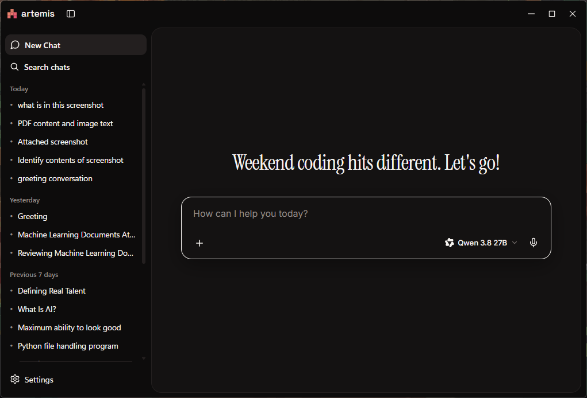
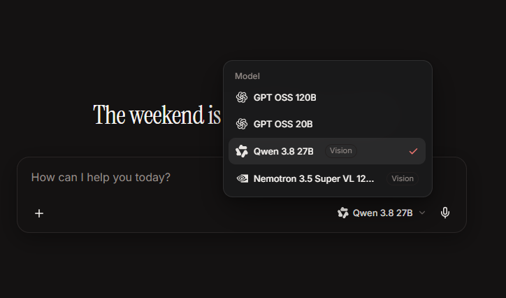
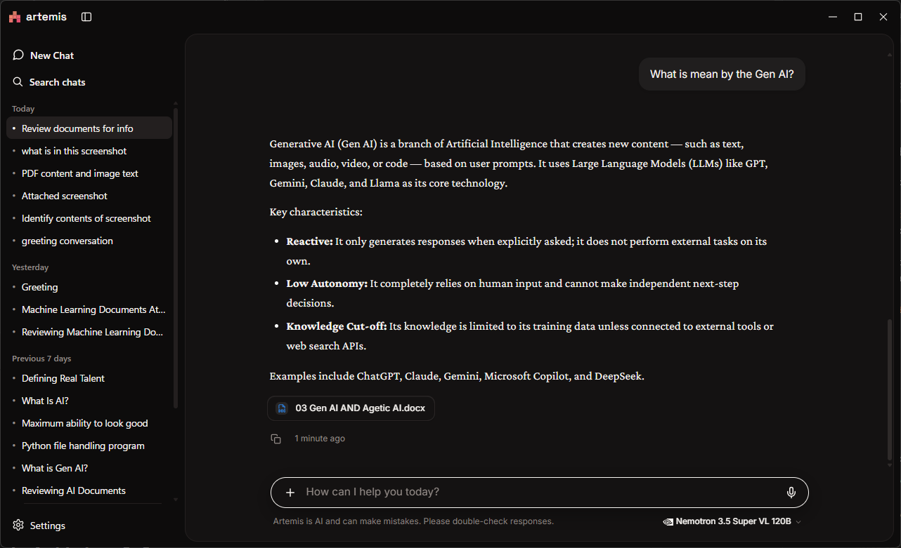
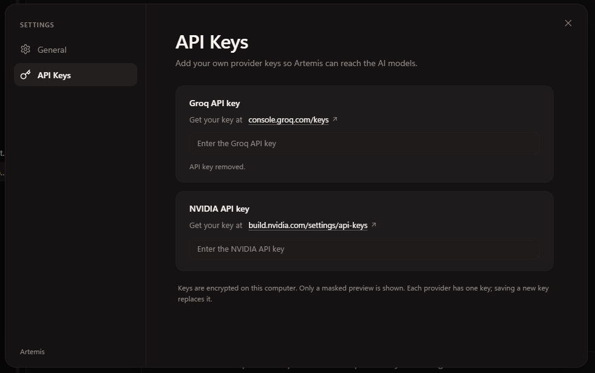

<div align="center">


# Artemis

**A desktop AI workstation with local document & codebase RAG, vision image chat, Whisper voice dictation, and multi-model streaming (Groq & NVIDIA).**

Run frontier AI models, converse with multiple documents (PDF, Word, Excel, PowerPoint) and entire codebases, chat with images via Vision models, stream real-time responses with syntax-highlighted code and KaTeX math, and manage isolated local histories — all within an ultra-sleek, frameless desktop environment.

[](https://microsoft.com/windows)
[](https://nodejs.org/)
[](https://www.electronjs.org/)
[](https://groq.com/)
[](https://github.com/abdulkarim20-ui/Artemis)
[](https://github.com/abdulkarim20-ui/Artemis)
[](...)
[](LICENSE)

*Windows 10/11 · Node.js 20.19+ · Electron · Local Document & Codebase RAG · Vision Image Chat · Groq & NVIDIA*

</div>

---

<p align="center">
  <video src="docs/recordings/demo.mp4" controls width="800"></video>
</p>

---

## 💡 Overview

Modern developers and researchers rely heavily on Large Language Models for architectural design, code generation, and complex document comprehension. However, common workflows create substantial friction:

- **Web-wrapper lock-in**: Browser-based interfaces lock users into single-provider subscriptions and scatter sensitive conversations across third-party cloud silos.
- **Document exposure**: Interrogating internal PDFs, spreadsheets, and source trees often requires uploading proprietary files to unverified cloud parsers.
- **Model rigidity**: Switching between sub-second latency for rapid iteration (Groq) and frontier reasoning with vision capabilities (NVIDIA Nemotron, Qwen) is awkward.
- **Fragile context boundaries**: Historical sessions are difficult to search, isolate, or preserve across reloads without cloud persistence.

**Artemis resolves this with complete desktop sovereignty.** It pairs a modern frameless Electron desktop interface with a dedicated loopback AI server on `127.0.0.1:3000`. Documents and code files are parsed, chunked, and indexed locally on your machine. Conversations are stored securely in your OS user profile, and token streaming delivers instant feedback through Server-Sent Events (SSE).

---

## ✨ Key Features

### 1. 🏠 Frameless Desktop Workspace & Dynamic Greetings
- **Custom Frameless Title Bar**: Native Windows controls (`minimize`, `maximize`, `restore`, `close`) with drag regions and fullscreen state sync.
- **Collapsible Sidebar**: Seamlessly switch between compact and expanded navigation with zero layout shift.
- **Time-Aware Dynamic Greetings**: Warm, contextual welcome messages tailored to morning, afternoon, evening, and late-night focus sessions.
- **Light & Dark Theme Engine**: Complete theme support with smooth transitions across backgrounds, borders, and typography.

<p align="center">
  
</p>

---

### 2. ⚡ Dynamic Model Selection & Vision Intelligence
- **Dynamic Model Registry**: Driven by backend `GET /api/models`, featuring automatic vendor brand badges (OpenAI, Qwen, NVIDIA Nemotron).
- **Multi-Modal Vision Support**: Attach or paste images directly (`Win + Shift + S`) for diagram analysis, UI reviews, and visual debugging.
- **Intelligent Auto-Switching**: If an image is attached while a text-only model is active, Artemis informs you and automatically selects a Vision-capable model without overwriting your default model preference.
- **Persistent Selection Memory**: Remembers your preferred model across restarts via local storage.

<p align="center">
  
</p>

---

### 3. 💬 Real-Time Streaming Markdown & Code Studio
- **SSE Token Streaming**: Smooth Server-Sent Events token stream with instant rendering and responsive UI interaction.
- **Syntax-Highlighted Code Blocks**: Code blocks with automatic language detection and a 1-click clipboard copy button.
- **KaTeX Mathematical Typesetting**: Full inline (`$...$`) and display (`$$...$$`) LaTeX math formulas rendered with KaTeX.
- **Rich Document Rendering**: Support for GitHub Flavored Markdown (GFM) tables, blockquotes, callout alerts, and clean typography.
- **Pixel Thinking Animation**: Visual reasoning loader that reflects model thinking state and allows expanding or collapsing model rationale.

<p align="center">
  
</p>

---

### 4. 📚 Local Document Processing & High-Accuracy RAG
- **Pragmatic, High-Accuracy Retrieval**: Artemis avoids unrealistic "100% accuracy" claims, instead delivering reliable, grounded answers via hybrid structure-aware retrieval. Headings, code functions, and tables are preserved intact with 1-based line number citations.
- **Source Verification & Grounded Citations**: The source panel exposes citations validated against actual passages and attached files. If the model omits explicit markers, a guarded fallback surfaces likely matches under *Related files*.
- **Local Parsing with Byte Sniffing**: Formats are inferred directly from byte signatures rather than trusting extensions, converting Word, PowerPoint, Excel, OpenDocument, RTF, EPUB, and text PDFs locally via AnyDoc without external conversion APIs.
- **Scanned Page Honesty**: Scanned PDFs that require OCR are detected immediately and reported with exact page numbers ("pages 2, 5–7 need OCR"), generating zero wasted embedding calls.
- **Content-Hashed Deduplication**: Attachments are indexed by SHA-256 hash. Re-attaching the same document across chat turns costs one local comparison, never redundant re-embeddings.

---

### 5. 🗄️ Isolated Local Chat History & Full Management
- **Dedicated Local Storage**: Every conversation, attachment, and AI-generated title lives in `<userData>/chats`, completely private and isolated on your disk.
- **Day-Grouped Timeline**: Conversations are cleanly organized into *Today*, *Yesterday*, and previous days.
- **Automatic Contextual Titling**: Artemis titles your conversations automatically from the semantic intent of your initial prompt.
- **History Tools**: Instant search filtering, inline chat renaming, and safe deletion with error recovery and active state memory.

---

### 6. 🎙️ Integrated Voice Input (Groq Whisper)
- **High-Speed Transcription**: Click the microphone to speak your prompt; voice is transcribed in seconds using Groq's `whisper-large-v3-turbo`.
- **In-Memory Audio Capture**: Audio recordings are processed in memory and never written to permanent disk storage.
- **Interactive Voice Controls**: Real-time animated waveform bar with immediate *Done* and *Cancel* controls.

---

### 7. 🔐 In-App API Key Manager & Dynamic Hot-Reload
- **Integrated Credentials Modal**: Configure `GROQ_API_KEY` and `NVIDIA_API_KEY` directly from the UI without manually editing files.
- **Masked Security**: Keys are masked upon entry and never exposed in cleartext to the renderer process.
- **Live Agent Restart**: Modifying or replacing an API key restarts the background AI agent dynamically without needing to relaunch the Electron application.

<p align="center">
  
</p>

---

## 📑 Supported Document & File Formats

Artemis converts and parses files locally inside the bundled AI runtime:

| Category | File Types & Extensions | Processing Details |
| :--- | :--- | :--- |
| **Documents** | `.pdf`, `.docx`, `.pptx`, `.xlsx`, `.odt`, `.rtf`, `.epub`, `.txt`, `.md` | Converted locally to structured Markdown. Spreadsheets convert to GFM tables; scanned PDF pages are flagged for OCR. |
| **Code & Scripts** | `.js`, `.ts`, `.jsx`, `.tsx`, `.py`, `.go`, `.rs`, `.c`, `.cpp`, `.cs`, `.java`, `.kt`, `.swift`, `.rb`, `.php`, `.sh`, `.lua`, `.scala`, `.dart`, `.ex`, `.clj` | Parsed with structure-aware chunking preserving classes, functions, and import headers. |
| **Data & Config** | `.json`, `.yaml`, `.yml`, `.toml`, `.xml`, `.csv`, `.sql`, `.dockerfile`, `.graphql`, `.proto` | CSV and tabular data ingest as text; configuration files retain indentation and block structure. |
| **Vision (Images)** | `.png`, `.jpg`, `.jpeg`, `.webp`, `.gif`, `.bmp` | Auto-scaled locally (max 1568 px) and forwarded to Vision-capable models (Qwen, Nemotron). |
| **Audio** | `.webm`, `.wav`, `.mp4` (audio stream) | Processed in-memory and transcribed via Groq Whisper API. |

---

## 🏛️ System Architecture

Artemis enforces strict separation of concerns across four cooperating layers:

```text
┌────────────────────────────────────────────────────────────────────────┐
│                        Electron Main Process                           │
│  - Window Management (window.js)        - App Lifecycle (main.js)      │
│  - Secure IPC Dispatcher (ipc.js)       - Subprocess Daemon (ai-server)│
└──────────────────┬─────────────────────────────────┬───────────────────┘
                   │                                 │
                   │ Preload Bridge                  │ Loopback HTTP + Token
                   │ (contextBridge / IPC)           │ (127.0.0.1:3000)
                   ▼                                 ▼
┌─────────────────────────────────────┐   ┌──────────────────────────────┐
│           Renderer Process          │   │       Bundled AI Agent       │
│ - Frameless Titlebar & Sidebar      │   │ - Express HTTP & SSE Server  │
│ - Streamed Markdown / KaTeX / Tables│   │ - Local AnyDoc Parser Engine │
│ - Dynamic Model Selector (Qwen/NVIDIA)  │ - Ingestion & Chunker Engine │
│ - Audio Voice Recorder (Groq Whisper)│   │ - Local Vector Store (bin/json)│
│ - In-App API Key Manager            │   │ - Groq SDK & NVIDIA Clients  │
└─────────────────────────────────────┘   └──────────────┬───────────────┘
                                                         │
                                           Cloud Calls   │ (Completions &
                                           with User Key │  Embeddings)
                                                         ▼
                                          ┌──────────────────────────────┐
                                          │   Groq & NVIDIA Endpoints    │
                                          │ - Groq Chat / Whisper STT    │
                                          │ - NVIDIA Nemotron / Embeddings│
                                          └──────────────────────────────┘
```

- **Loopback Token Authentication**: The background agent is protected by a random 32-byte secret generated per launch (`ARTEMIS_SHUTDOWN_TOKEN`), preventing rogue local processes from querying or stopping your AI server.
- **Process Isolation**: Renderer runs with `contextIsolation: true`, `nodeIntegration: false`, and `sandbox: true`. External hyperlinks open in the user's default OS browser, never inside the app.

---

## 🚀 Quick Start

### Prerequisites
- **Windows 10** or **Windows 11** (x64)
- **Node.js 20.19** or newer
- At least one API key:
  - **[Groq API Key](https://console.groq.com/)** (for ultra-fast chat completions and Whisper voice transcription)
  - **[NVIDIA API Key](https://build.nvidia.com/)** (for Nemotron reasoning, Vision, and RAG knowledge base embeddings)

### Installation

```bash
# 1. Clone the repository
git clone https://github.com/abdulkarim20-ui/Artemis.git
cd Artemis

# 2. Install dependencies (root package and AI agent)
npm install

# 3. Create environment configuration
copy .env.example .env
```

Open `.env` in your editor and add your API keys:

```ini
GROQ_API_KEY=your_groq_api_key_here
NVIDIA_API_KEY=your_nvidia_api_key_here
```

### Launch Application

```bash
# Start Artemis (launches both the Electron window and the bundled AI agent)
npm start
```

### Standalone Development Agent

If you want to run or debug only the AI backend server without Electron:

```bash
npm run agent
```

### Run Test Suite

```bash
npm test
```

The comprehensive test suite covers document conversion, token budgeting, chunking, vector math, citation extraction, IPC contracts, and renderer views using the native Node.js test runner.

### Build Production Installer

```bash
npm run dist
```

Generates production Windows binaries and setup installers under `dist/`.

---

## ⚙️ Configuration & Environment Variables

Key parameters configurable via `.env` or in-app Settings:

| Variable | Default | Purpose |
| :--- | :--- | :--- |
| `GROQ_API_KEY` | *None* | Authentication key for Groq LLMs and Whisper voice input. |
| `NVIDIA_API_KEY` | *None* | Authentication key for Nemotron chat, Vision, and RAG embeddings. |
| `ARTEMIS_PORT` | `3000` | Port for the local loopback AI agent server. |
| `GROQ_MAX_COMPLETION_TOKENS` | `4096` | Upper limit on generated tokens for Groq models. |
| `GROQ_STT_MODEL` | `whisper-large-v3-turbo` | Whisper speech-to-text model identifier. |
| `ARTEMIS_RAG_DISABLED` | `0` | Set to `1` to disable the vector knowledge base retrieval engine. |
| `ARTEMIS_RAG_DIR` | `<userData>/rag` | Directory path where local vector indices and chunks are stored. |

---

## 🛡️ Privacy & Security

- **Local File Safety**: Documents attached to chats are parsed, chunked, and stored locally on your machine.
- **Local Chat Isolation**: All chat transcripts, session metadata, and uploaded attachments live strictly under `<userData>/chats`.
- **Transparent Model Transmission**:
  - Prompt text and converted document contents are sent only to the provider of the selected model (Groq or NVIDIA).
  - Images are sent only when a Vision model is active and are downscaled on your device prior to transmission.
  - Text chunks indexed into the knowledge base are embedded through NVIDIA's hosted vector endpoint (`integrate.api.nvidia.com`). You can switch retrieval off at any time with `ARTEMIS_RAG_DISABLED=1`.
- **Zero Third-Party Telemetry**: Artemis bundles zero user analytics, trackers, or telemetry SDKs.

---

## 📜 License & Credits

- **License**: Artemis source code is open source under the [MIT License](LICENSE).
- **Core Dependencies**:
  - [Electron](https://www.electronjs.org/) & [Electron Builder](https://www.electron.build/)
  - [AnyDoc](https://github.com/firecrawl/anydoc) for local document parsing
  - [KaTeX](https://katex.org/) for fast mathematical typesetting
  - [Marked](https://marked.js.org/) & [DOMPurify](https://github.com/cure53/DOMPurify) for sanitized markdown streaming
  - [Highlight.js](https://highlightjs.org/) for code syntax highlighting
- Third-party licenses and notices are documented in [THIRD_PARTY_NOTICES.md](THIRD_PARTY_NOTICES.md).

Copyright &copy; 2026 **AbdulKarim**. All rights reserved.

<div align="center">

---

**Artemis** · *Sovereign Desktop AI · Local Intelligence · Private by Design*

</div>
